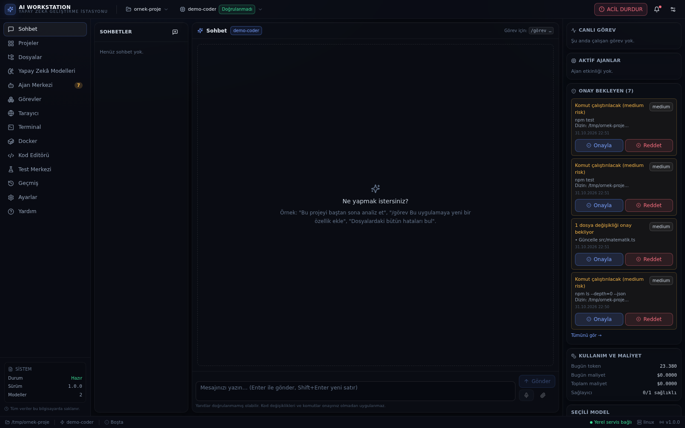
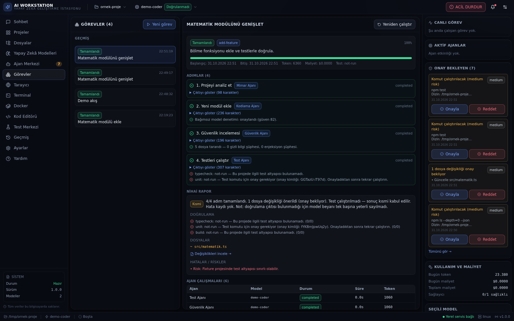
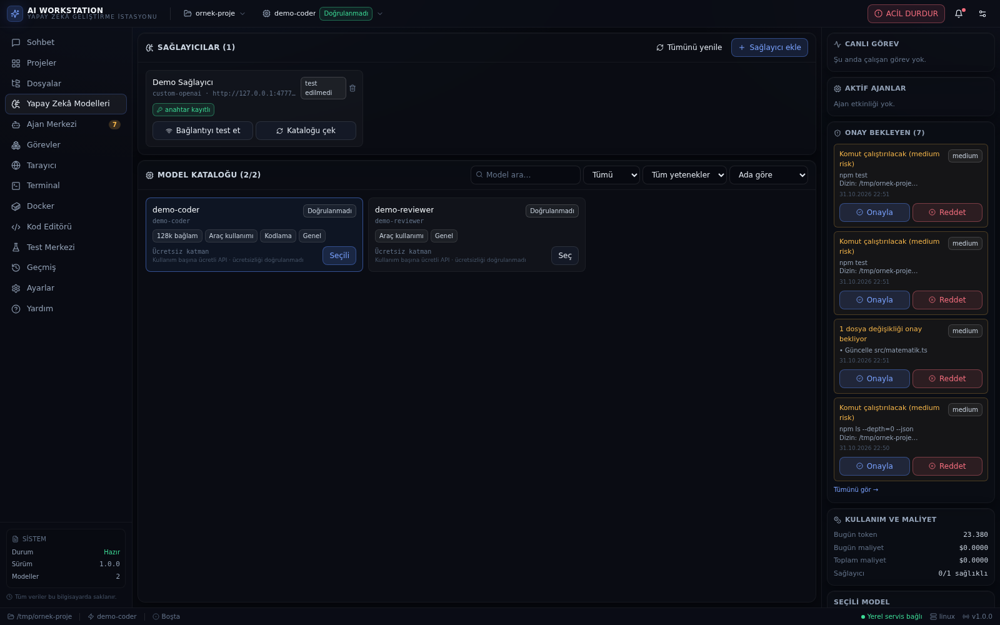
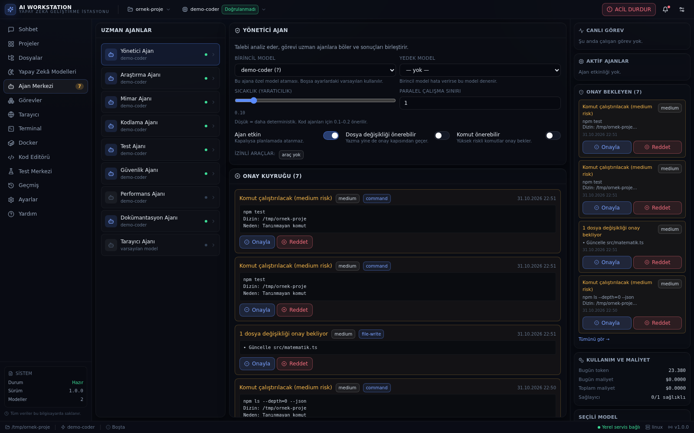
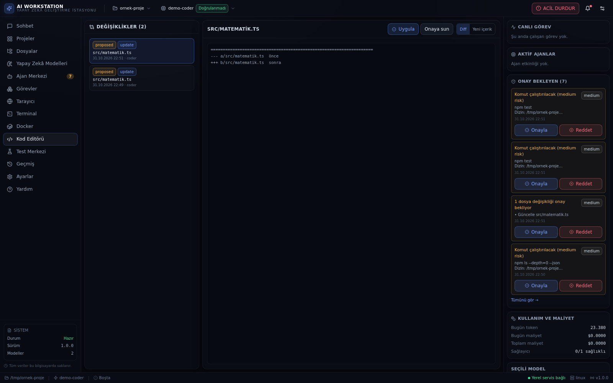
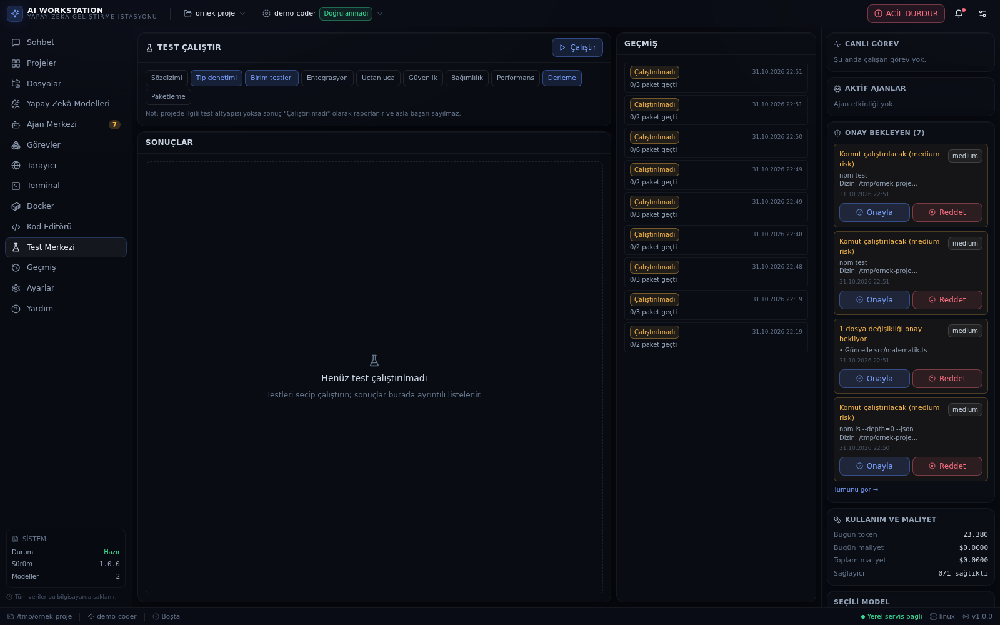
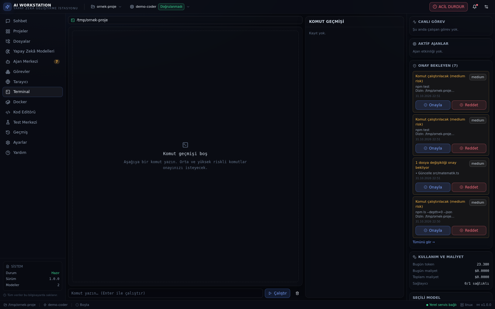
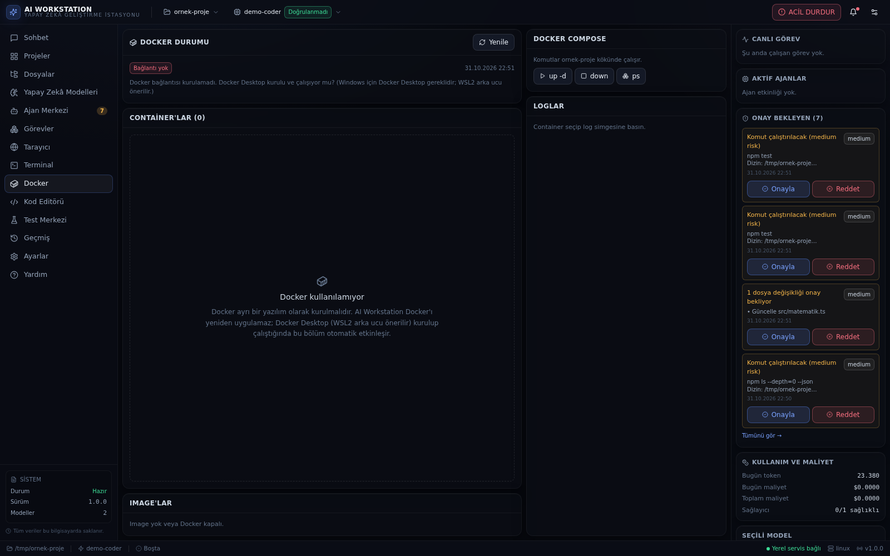

# AI WORKSTATION

**Yapay Zekâ Geliştirme İstasyonu** — Windows üzerinde çalışan, çoklu model ve çoklu ajan destekli masaüstü geliştirme/otomasyon platformu.

> Sürüm: **1.0.0** · Arayüz dili: **Türkçe** · Platform: **Windows 10/11 (x64)** · Mimarî: **Electron + Fastify + SQLite + React**

---

## 1. Bu nedir?

AI Workstation, bir yazılım projesini baştan sona ele alabilen yerel bir masaüstü uygulamasıdır:

- **Model Merkezi** — OpenAI, Google Gemini, Anthropic, xAI, DeepSeek, Mistral, OpenRouter, Hugging Face ve OpenAI uyumlu her uç nokta tek yerden yönetilir (puan sıralaması: bkz. `spec/eksikler/E-45-puan-siralama.md`). Anahtarlar yalnızca ana süreçte (main process) şifreli olarak saklanır.
- **Ajan Sistemi** — Yönetici, Araştırma, Mimar, Kodlama, Test, Güvenlik, Performans ve Dokümantasyon ajanları birlikte çalışır; sonuçlar gerçek test/derleme çıktılarıyla doğrulanır.
- **Görev Yönetimi** — 12 adımlı iş akışı, duraklat/devam/iptal, onay kuyruğu, kalıcı geçmiş.
- **Proje & Dosya Yönetimi** — Monaco tabanlı Türkçe arayüz, diff görünümü, otomatik yedek, yol-kaçışı (path traversal) koruması.
- **Terminal** — PowerShell / CMD / WSL / Git Bash; her komut risk sınıfına göre onay ister.
- **Docker** — konteyner, imaj, compose ve günlük yönetimi; yüksek riskli işlemler ayrıca onaylanır.
- **Tarayıcı Otomasyonu** — Playwright + gömülü sekmeler; DOM okuma, tıklama, ekran görüntüsü.
- **Test Merkezi** — birim, tip denetimi ve derleme testleri; "çalıştırılmadı" sonucu asla "geçti" olarak gösterilmez.
- **Sesli İletişim** — Türkçe konuşma tanıma ve seslendirme (değiştirilebilir sağlayıcı mimarisi).
- **Güvenlik** — `contextIsolation`, `sandbox`, katı CSP, IPC beyaz listesi, anahtar kasası, acil durdurma, bilgi istemi enjeksiyonu savunması.

---

## 2. Kurulum

### 2.1 Kurulum dosyasıyla (önerilen)

| Dosya | Açıklama |
| --- | --- |
| `AI_WORKSTATION_Setup.exe` | Kurulum sihirbazı. Kullanıcı dizinine kurulur, yönetici yetkisi istemez. |
| `AI_WORKSTATION_Portable.exe` | Kurulum gerektirmez; USB bellekten çalıştırılabilir. |

1. `AI_WORKSTATION_Setup.exe` dosyasına çift tıklayın.
2. Windows SmartScreen uyarısı görürseniz **Ek bilgi → Yine de çalıştır** seçin (dosya kod imzalı değildir; SHA-256 özetini `SHA256SUMS.txt` ile karşılaştırın).
3. Kurulum dizinini seçin, **Kur** düğmesine basın.
4. Masaüstü kısayolundan uygulamayı açın.

İlk açılışta uygulama:
- `%APPDATA%\AIWorkstation\workstation.db` (SQLite) veritabanını oluşturur,
- yerel servisi yalnızca `127.0.0.1` üzerinde rastgele bir bağlantı noktasında başlatır,
- arayüzü bu yerel servise bağlar.

### 2.2 Kaynaktan çalıştırma (geliştirici)

```powershell
git clone https://github.com/KULLANICI_ADI/ai-workstation.git
cd ai-workstation
npm run kur
```

`npm run kur` şunları sırayla yapar: bağımlılıkları kurar, Windows için
`better-sqlite3` ikilisini yerleştirir, Electron çalışma zamanını indirir,
Monaco dosyalarını kopyalar.

Sonra:

```powershell
npm run dev:backend        # arka uç (varsayılan 47110)
npm run dev                # arayüz (5173)
# veya masaüstü kabuğu:
npm run dev:electron
```

Gereksinimler: **Node.js 20–26**, **npm 10+**. Node **26 LTS** önerilir.
Docker ve tarayıcı otomasyonu isteğe bağlıdır; kurulu değilse ilgili modüller
arayüzde açıkça "kullanılamıyor" olarak gösterilir.

#### `npm ci` neden çökebilir? (önemli)

`better-sqlite3` yerel bir modüldür. Kurulum sırasında `prebuild-install`
hazır ikiliyi **GitHub Releases**'ten indirmeye çalışır:

```
https://github.com/WiseLibs/better-sqlite3/releases/download/v12.11.1/
    better-sqlite3-v12.11.1-node-v147-win32-x64.tar.gz
```

Bazı ağlarda (Türkiye'de sık) bu adres **404** döner. O zaman `prebuild-install`
kaynaktan derlemeye düşer, `node-gyp` **Visual Studio C++** ister ve `npm ci`
şu hatayla çöker:

```
gyp ERR! find VS could not find a version of Visual Studio 2017 or newer
```

**Çözüm:** hazır ikili depoda. `npm run kur` bunu otomatik kullanır.
Elle yapmak isterseniz:

```powershell
npm ci --ignore-scripts
node scripts/fix-native-win.mjs     # tools/prebuilds/ içindeki arşivi kullanır
npm run monaco
npm run verify
```

`scripts/fix-native-win.mjs` dosyası `tools/prebuilds/` altındaki Windows
ikilisini (`better-sqlite3-v12.11.1-node-v<ABI>-win32-x64.tar.gz`) alır,
PE32+ imzasını doğrular ve `node_modules/better-sqlite3/build/Release/`
içine koyar. **İnternet gerekmez.**

| Node | ABI | Arşiv |
|---|---|---|
| 20 | 115 | depoda yok |
| 22 | 127 | ✔ |
| 26 | 147 | ✔ |

> Node 20 veya 24/25 kullanıyorsanız ilgili arşivi
> [better-sqlite3 sürümleri](https://github.com/WiseLibs/better-sqlite3/releases/tag/v12.11.1)
> adresinden indirip `tools/prebuilds/` içine koyun.

### 2.3 Windows kurulum dosyasını üretme

```powershell
powershell -ExecutionPolicy Bypass -File scripts\build-windows.ps1
```

veya GitHub Actions üzerinden: **Actions → Windows kurulum dosyası → Run workflow**.

---

## 3. İlk kullanım (5 dakika)

1. **Yapay Zekâ Modelleri** sayfasında **+ Sağlayıcı ekle**'yi seçin (ör. Google Gemini — ücretsiz katmanı vardır).
2. API anahtarını girin → **Bağlantıyı test et** → **Kataloğu çek**.
3. **Yapay Zekâ Modelleri** sayfasında modeli seçin (sağ üstteki model çubuğundan da değiştirilebilir).
4. **Projeler → Proje ekle** ile çalışmak istediğiniz klasörü seçin.
5. **Sohbet** ekranında:
   - normal mesaj → sohbet yanıtı,
   - `/görev <açıklama>` → çok ajanlı görev başlatır,
   - `/analiz` → proje analizi,
   - `/test` → testleri çalıştırır.
6. Ajanlar dosya değişikliği önerdiğinde **Kod Editörü** sayfasında diff'i inceleyin, **Uygula** ile onaylayın. Onay olmadan hiçbir dosya yazılmaz.

---

## 4. Mimari

```
AI_WORKSTATION/
├── electron/          → Masaüstü kabuğu (main, preload, IPC, tarayıcı köprüsü)
├── backend/           → Fastify yerel servisi (yalnızca 127.0.0.1)
│   ├── database/      → SQLite şeması, migrasyonlar, yedekleme
│   ├── security/      → kasa, maskleme, yol doğrulama, risk sınıflandırma
│   ├── memory/        → ayarlar, bağlam, kalıcı bellek tabloları
│   ├── ai/            → sağlayıcı adaptörleri + model ağ geçidi
│   ├── projects/ files/ terminal/ docker/ browser/ testing/
│   ├── agents/        → 8 uzman ajan + yönetici ajan
│   ├── orchestration/ → 12 adımlı görev akışı, dosya kilidi, onay kuyruğu
│   └── server/        → uygulama, rotalar, konteyner
├── shared/types/      → Ana süreç ↔ arayüz arasındaki DONDURULMUŞ sözleşme
├── src/               → React arayüzü (14 sayfa, Türkçe)
├── tests/             → 20 dosya / 143 test (bkz. TEST_REPORT.md)
├── scripts/           → derleme, paketleme, sahte sağlayıcı, duman testi
├── docs/              → kurulum, kullanım, güvenlik belgeleri
└── resources/icons/   → uygulama ikonları (16–1024 px + .ico)
```

**Katman kuralı:** arayüz hiçbir zaman doğrudan dosya sistemine, shell'e veya sağlayıcı API'sine erişmez. Tüm işlemler tipli `api()` çağrılarıyla arka uca gider; arka uç her isteği doğrular, risk sınıflandırır ve gerekirse onaya sunar.

**Anahtar güvenliği:** API anahtarları renderer'a hiçbir koşulda gönderilmez. Veritabanında `safeStorage` (Windows DPAPI) ile şifrelenir; yalnızca ana süreçte çözülür ve yalnızca ilgili sağlayıcı isteğinde kullanılır.

---

## 5. Ekranlar

| Sohbet | Görevler |
| --- | --- |
|  |  |

| Yapay Zekâ Modelleri | Ajan Merkezi |
| --- | --- |
|  |  |

| Kod Editörü (diff + onay) | Test Merkezi |
| --- | --- |
|  |  |

| Terminal | Docker |
| --- | --- |
|  |  |

Diğer ekranlar: [`docs/ekranlar/`](docs/ekranlar/) (Projeler, Dosyalar, Tarayıcı, Geçmiş, Ayarlar, Yardım).

## 6. Sayfalar

| Sayfa | İşlev |
| --- | --- |
| **Sohbet** | Akışlı yanıt, `/görev` komutları, sesli giriş/çıkış, onay uyarıları |
| **Projeler** | Klasör ekleme, sağlık taraması, bağımlılık bilgisi |
| **Dosyalar** | Ağaç görünümü, önizleme, arama, yedekler |
| **Yapay Zekâ Modelleri** | Sağlayıcı ekleme, bağlantı testi, katalog, sıralama/filtre |
| **Ajan Merkezi** | Ajan başına model, sıcaklık, araç izinleri, onay kuyruğu |
| **Görevler** | 12 adımlı akış, adım çıktıları, nihai rapor, doğrulama |
| **Tarayıcı** | Sekmeler, adres çubuğu, DOM, ekran görüntüsü |
| **Terminal** | Kabuk seçimi, risk etiketi, onay kartı, geçmiş |
| **Docker** | Konteyner/imaj/compose, günlükler, riskli işlem onayı |
| **Kod Editörü** | Monaco, diff, uygula/geri al, sözdizimi renklendirme |
| **Test Merkezi** | Test çalıştırma, sonuç tablosu, kapsam |
| **Geçmiş** | Görev/sohbet/komut/değişiklik kayıtları, denetim izi |
| **Ayarlar** | Genel, yapay zekâ, ajanlar, dosyalar, terminal, ses, güvenlik, yedekleme, hakkında |
| **Yardım** | Kısayollar, risk sınıfları, sorun giderme |

**Kısayollar:** `Ctrl+Shift+Escape` → acil durdurma (tüm ajan, komut ve Docker işlemlerini derhal durdurur). `Enter` → mesajı gönder, `Shift+Enter` → yeni satır.

---

## 7. Güvenlik özeti

- `contextIsolation: true`, `sandbox: true` (CJS preload), `nodeIntegration: false`, `webSecurity: true`.
- Ön yük (preload) yalnızca `/api/` ile başlayan ve izinli HTTP yöntemlerini kabul eder.
- CSP: `default-src 'self'`; dış bağlantılar yalnızca `connect-src` ile sağlayıcı alan adlarına.
- Tüm dosya işlemleri proje köküne hapsedilir; sembolik bağlantılar çözümlenir, `..` ve sürücü kaçışları reddedilir.
- Kabuk komutları yeniden yazılmaz; risk sınıfına göre onay istenir. `| sh`, `rm -rf`, disk biçimlendirme gibi kalıplar **kritik** sayılır.
- Web sayfası ve dosya içerikleri **güvenilmez** kabul edilir; model çıktısı komut olarak yorumlanmaz.
- Denetim günlüğü: her onay, komut, dosya değişikliği ve ajan adımı kaydedilir.

Ayrıntılar: [`SECURITY_REPORT.md`](SECURITY_REPORT.md)

---

## 8. Bilinen sınırlar (dürüst beyan)

| Konu | Durum |
| --- | --- |
| Bulut modeli çağrıları | Kullanıcı anahtarı gerekir. Anahtar yoksa uygulama açıkça "anahtar yok" der, sahte yanıt üretmez. |
| Ücretsiz katman bilgisi | Yalnızca sağlayıcının resmî olarak duyurduğu kotalar gösterilir; "doğrulanmamış ücretsiz" etiketi kullanılmaz. |
| **Windows EXE üretimi** `[DOĞRULANMADI]` | Bu depo Linux üzerinde hazırlandı; `.exe` **bu ortamda hiç üretilmedi ve Windows'ta hiç denenmedi**. Yapılandırma (`electron-builder.yml`), ikon ve `scripts\build-windows.ps1` hazırdır. Doğrulama adımı: Windows'ta `npm run build:win` → `release\AI_WORKSTATION_Setup.exe` çift tıkla → kur → aç. Bu adım yapılmadan "çalışıyor" denmez. |
| **CI (GitHub Actions)** `[DOĞRULANMADI]` | `.github/workflows/build-windows.yml` yalnızca `workflow_dispatch` ve `v*` etiketinde çalışır; bu depoda hiç çalıştırılmadı (koşu günlüğü yok). Yapılandırma okunabilir ancak koşu kanıtı yoktur. |
| **Kod imzalama** `[EKSİK]` | Yapılandırılmadı: `electron-builder.yml` içinde `win.signingHashAlgorithms`, `certificateFile` veya `azureSignOptions` yok. Üretilen kurulum dosyası **imzasız** olur; SmartScreen uyarır. Şirket sertifikası eklenmesi E-41 kapsamındadır. |
| **Otomatik güncelleme** `[EKSİK]` | `electron-updater` **`package.json` bağımlılıklarında yok**; `publish` bloğu ve güncelleme kontrol kodu yok. Güncelleme özelliği **yoktur** (E-40). |
| WSL / Docker / Playwright | Sistemde kurulu değilse ilgili modül "kullanılamıyor" durumunda kalır; uygulama çökmez. |

---

## 8.1 Şartname ve eksik kayıtları

| Belge | İçerik |
| --- | --- |
| [`spec/AI_WORKSTATION_SPEC_v2.md`](spec/AI_WORKSTATION_SPEC_v2.md) | Denetlenmiş ana şartname: 14 modül, çelişki çözümleri, senaryo matrisleri, kabul kriterleri |
| [`spec/ANA_EKSIK_LISTESI.md`](spec/ANA_EKSIK_LISTESI.md) | **Ana eksik listesi** — 48 kayıt, durum etiketleriyle (tek kaynak) |
| [`spec/YOL_HARITASI.md`](spec/YOL_HARITASI.md) | Tek yol haritası — 48 kaydın aşamalara bölünmüş planı |
| [`spec/KABUL_TEST_MATRISI.md`](spec/KABUL_TEST_MATRISI.md) | Kabul test matrisi — hangi test hangi maddeyi kanıtlıyor |
| [`spec/IZLENEBILIRLIK_TABLOSU.md`](spec/IZLENEBILIRLIK_TABLOSU.md) | Belge–kod izlenebilirlik tablosu (43 satır) |
| [`spec/EKSIKLER_OZET.md`](spec/EKSIKLER_OZET.md) | 48 eksik kaydı, öncelik/efor/bağımlılık tablosu (ikincil) |
| [`spec/eksikler/`](spec/eksikler/) | Her eksik için teknik uygulama, kabul ve test kriterleri |
| [`spec/AI_WORKSTATION_SPEC_v2.md` §32](spec/AI_WORKSTATION_SPEC_v2.md) | Belge–kod uyuşmazlıkları (U1–U12; U10–U12 kapandı) |
| [`spec/DENETIM_RAPORU_2.md`](spec/DENETIM_RAPORU_2.md) | İkinci denetim raporu — 12 maddenin kanıtlı karşılığı |

> **Sürümler:** Uygulama sürümü **1.0.0** (`package.json` + `shared/constants.ts → APP_VERSION`), şartname sürümü **AWS-SPEC-2.0** (`shared/constants.ts → SPEC_VERSION`). İkisi bağımsızdır ve `npm run verify` uyuşmayı denetler.
>
> **Dürüst durum:** 8 ana modül çalışır durumda ve 143 otomatik test + 37 uçtan uca kontrol geçmektedir. 16 P1 eksik kaydı üretim öncesi kapatılmalıdır.
> Model puanına göre sıralama **henüz yok** (E-45); Windows kurulum dosyası **bu depoda üretilmedi ve denenmedi** (E-41); otomatik güncelleme **yok** (E-40).

## 9. Geliştirme komutları

```bash
npm run dev            # arayüz (Vite)
npm run dev:backend    # arka uç (tsx)
npm run dev:electron   # masaüstü kabuğu (electron-vite dev)
npm test               # 143 test (bkz. TEST_REPORT.md)
node scripts/verify-release.mjs  # tam doğrulama kapısı (tür + test + derleme + e2e)
npm run typecheck      # tsc --noEmit
npm run build          # arayüz derlemesi
npm run build:electron # Electron derlemesi
npm run package:win    # Windows kurulum dosyaları (Windows'ta)
npm run verify         # tam doğrulama kapısı (tür + test + derleme + e2e)
npm run e2e            # uçtan uca senaryo (37 kontrol)
npm run release        # derleme + ZIP + SHA-256
npm run mock           # sahte sağlayıcı (anahtarsız demo)
```

---

## 10. Lisans

Özel kullanım lisansı — bkz. [`LICENSE.txt`](LICENSE.txt). Üçüncü taraf bileşenler kendi lisansları altındadır.

---

**Destek:** Sorun giderme için `docs/KULLANIM_TR.md` içindeki "Sık karşılaşılan sorunlar" bölümüne bakın.
